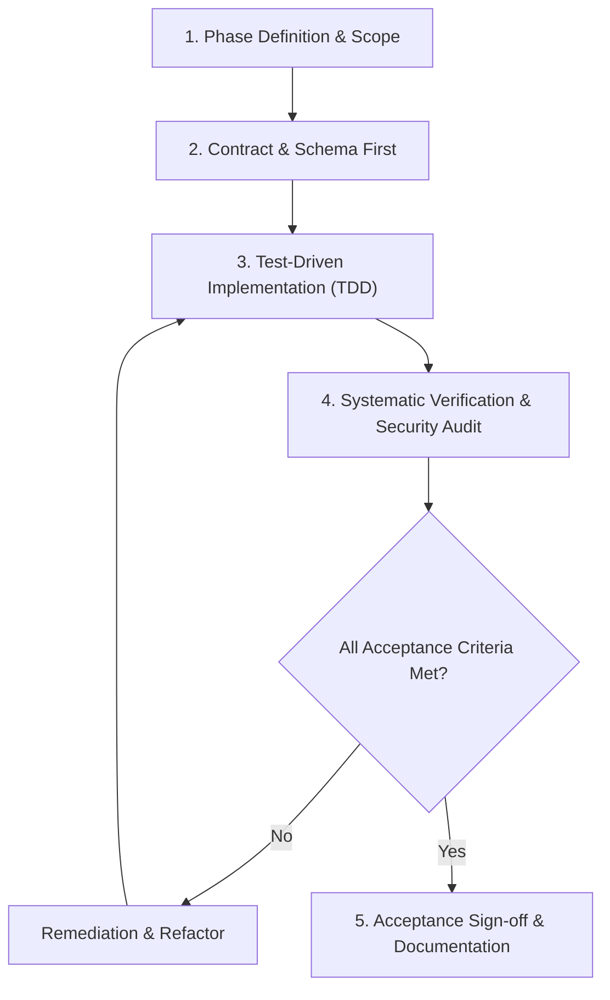

# miConte Phase Workflow: Implementation, Review, and Acceptance

This skill governs how work is structured, developed, verified, and accepted across all phases of the **miConte** content intelligence platform.

miConte enforces disciplined engineering: every phase has strict input requirements, implementation gates, automated verification, and explicit acceptance criteria before any code is considered complete.

---

## 1. Principles

1. **Deterministic Core**: miConte operates fundamentally without LLM or MCP dependencies. All business logic, statistical processing, and database operations must be standalone, deterministic, and fully testable offline.
2. **Phase Isolation**: Do not start implementing features of Phase $N+1$ until Phase $N$ meets all acceptance criteria and passes verification.
3. **No Unverified Completion**: Never declare a phase or task complete without fresh, reproducible execution evidence (test runs, migration checks, build outputs).

---

## 2. Phase Lifecycle

---

## 3. Step-by-Step Procedure

### Step 1: Definition & Scope
Before writing implementation code:
- Identify the explicit user stories or technical objectives of the current phase.
- List all deliverables: API endpoints, database models, migrations, analytical services, and Angular components.
- Check dependencies: Ensure required preceding phases/schemas are finalized and migrations applied.

### Step 2: Contract & Schema First
- **Data Models**: Define SQLAlchemy models and Alembic migration scripts. Never modify tables manually in PostgreSQL.
- **API Contracts**: Define Pydantic request and response schemas with strict type hints (`Annotated`, `Field`, validation constraints).
- **Frontend Interfaces**: Define matching TypeScript interfaces in Angular to ensure end-to-end type safety between FastAPI and Angular.
- **Architectural Fit**: Verify no cyclic dependencies are introduced between modules (`api`, `core`, `models`, `schemas`, `services`).

### Step 3: Test-Driven Implementation
Follow the Red-Green-Refactor workflow:
1. **Red**: Write unit and integration tests in `pytest` (backend) or Jasmine/Karma/Playwright (frontend) before writing feature code.
2. **Green**: Write the minimal code required to pass the test suite.
3. **Refactor**: Clean code structure, adhere to clean architecture patterns, eliminate duplication, and preserve readability.
4. **Offline Validation**: Confirm all tests pass without network access and without calling LLM endpoints.

### Step 4: Verification & Security Audit
Run the verification gate:
- **Linting & Types**:
  - Backend: `ruff check .` and `mypy` type checking.
  - Frontend: `ng lint` (or ESLint) and `tsc --noEmit`.
- **Automated Tests**:
  - Run `pytest -v` with coverage metrics.
  - Ensure zero skipped or broken tests.
- **Database Consistency**:
  - Validate Alembic migrations (`alembic upgrade head`).
  - Ensure proper indexing, foreign keys, and constraints (following `postgres-best-practices`).
- **Security Audit**:
  - Check for SQL injection (rely strictly on parameterized ORM queries).
  - Verify input sanitization, CORS configuration, and absence of hardcoded credentials.

### Step 5: Acceptance Sign-Off
A phase is accepted **only** when all items in the checklist below are verified with terminal output evidence:

- [ ] All scoped endpoints and features are implemented.
- [ ] Backend test suite passes (`pytest`, 100% green).
- [ ] Frontend builds cleanly without TypeScript or template errors (`ng build`).
- [ ] Database migrations run forward and rollback cleanly (`alembic upgrade head` / `downgrade -1`).
- [ ] Statistical methods conform to `miconte-statistical-validation`.
- [ ] Documentation updated (README, API docs, schemas).
- [ ] Zero unhandled errors or deprecation warnings in logs.
