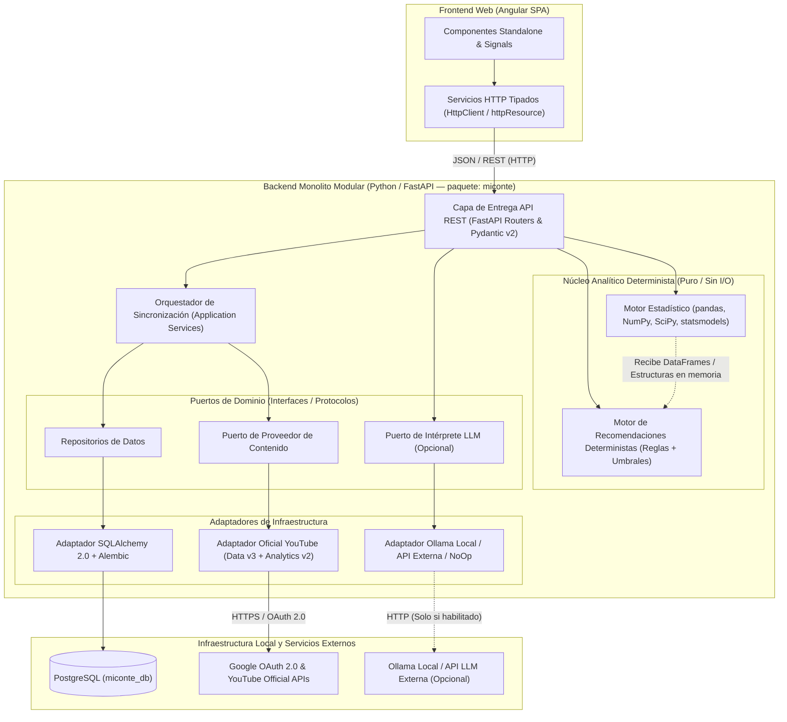

# Arquitectura del Sistema — miConte (`docs/architecture.md`)

## 1. Visión General y Estilo Arquitectónico

**miConte** adopta una arquitectura de **Monolito Modular con límites hexagonales (Puertos y Adaptadores)** en el backend, acoplada a una aplicación web de página única (**SPA en Angular**) en el frontend y una base de datos relacional (**PostgreSQL: `miconte_db`**).

Esta decisión responde directamente a los principios del proyecto:
* Evita la sobrecarga operativa e infraestructura innecesaria de los microservicios.
* Garantiza límites estrictos entre módulos internos para que el **Motor Estadístico** y el **Motor de Recomendaciones Deterministas** sean paquetes puros de dominio que no dependen de FastAPI, SQLAlchemy, YouTube APIs, LLMs ni MCP.
* Permite sustituir el proveedor de IA (Ollama local o API externa) o añadir futuras fuentes de contenido (TikTok, Instagram post-MVP) implementando nuevos adaptadores sin modificar el núcleo analítico.

---

## 2. Límites y Responsabilidades de los Componentes

### 2.1 Backend y API REST (`miconte.api`)
* **Responsabilidad:** Exponer los casos de uso mediante endpoints HTTP RESTful, validar parámetros de entrada y serializar respuestas utilizando esquemas **Pydantic v2** y declaraciones tipadas con `Annotated[..., Depends(...)]`.
* **Límites:** No contiene lógica matemática ni consultas SQL directas. Traduce solicitudes HTTP en llamadas a los servicios de aplicación y envuelve los resultados con metadatos de trazabilidad (`source`, `period`, `unit`, `limitations`).

### 2.2 Persistencia y Repositorios (`miconte.persistence`)
* **Responsabilidad:** Gestionar el ciclo de vida de las sesiones de base de datos hacia PostgreSQL (`miconte_db`), definir los modelos relacionales con **SQLAlchemy 2.0** (estilo declarativo `Mapped` y `mapped_column`), gestionar las migraciones con **Alembic** y encapsular las consultas SQL detrás de repositorios especializados.
* **Límites:** Convierte modelos ORM en objetos de dominio o `pandas.DataFrame` antes de entregarlos al motor estadístico, evitando que los objetos de sesión de SQLAlchemy se filtren hacia la capa analítica.
* **Esquema Relacional Especializado (Fase 3 / ADR-0005):**
  * **Seguridad y Usuarios (`users`, `oauth_connections`):**
    * Aislamiento multi-usuario estricto mediante claves foráneas directas (`user_id`).
    * **Distinción de Seguridad sobre Tokens OAuth (Fase 3 vs. Fase 4):** La tabla `oauth_connections` define las columnas `encrypted_access_token` y `encrypted_refresh_token` como **campos reservados para almacenar texto cifrado (*ciphertext*)**. La mera presencia de estas columnas en la base de datos **no garantiza por sí sola que los valores persistidos estén cifrados**. Se distinguen formalmente tres niveles: (1) las columnas receptoras del esquema (Fase 3), (2) el servicio de cifrado y descifrado autenticado (pendiente para la Fase 4) y (3) la gestión y protección de las claves criptográficas fuera de la base de datos (Fase 4). Queda establecido que la **Fase 4** deberá implementar y probar exhaustivamente el mecanismo criptográfico (usando cifrado autenticado como AES-GCM con una biblioteca mantenida como `cryptography`, claves separadas de la base de datos, pruebas de detección de modificaciones y prohibición de texto plano o registro en logs) **antes de permitir el almacenamiento de tokens OAuth reales**.
  * **Catálogo Descriptivo (`channels`, `videos`):** Metadatos estables de canales y videos. Incluye `channels.uploads_playlist_id` para enumeración paginada sin consumir cuota de `search.list` y restricción `CHECK (duration_seconds >= 0)`.
  * **Instantáneas Públicas (`channel_public_snapshots`, `video_public_snapshots`):** Capturas históricas acumuladas en `captured_at`. Distingue nítidamente entre ausencia (`NULL`, creador ocultó o desactivó la estadística) y cero (`0`). Claves compuestas únicas `(channel_id, captured_at)` y `(video_id, captured_at)`.
  * **Métricas Analíticas Privadas por Periodo (`channel_daily_metrics`, `video_daily_metrics`, `video_period_metrics`):**
    * Tablas fuertemente tipadas en lugar de EAV para permitir carga vectorizada directa a `pandas.DataFrame`.
    * Contrato de `likes` no negativo con aislamiento de anomalías (`CHECK (likes >= 0 OR is_anomalous = TRUE)`).
    * Métricas de alcance (`thumbnail_impressions`, `thumbnail_ctr`, `reach_source`) estrictamente anulables para operar con o sin `Reporting API v1`.
  * **Auditoría y Recomendaciones (`sync_runs`, `analysis_runs`, `recommendations`):** Trazabilidad de sincronizaciones, ejecuciones analíticas con tamaño muestral $N$ y diagnósticos descriptivos deterministas no causales.

### 2.3 Integración con YouTube (`miconte.integrations.youtube`)
* **Responsabilidad:** Autenticar mediante OAuth 2.0 (solo lectura), consumir `YouTube Data API v3` y `YouTube Analytics API v2` mediante `HTTPX` o el cliente oficial de Google, controlar el presupuesto de cuotas (*quota tracker*), manejar paginación y transformar las respuestas crudas de Google en DTOs normalizados de ingesta.
* **Límites:** Es el único módulo que conoce las particularidades del protocolo de YouTube. Implementa un contrato genérico (`ContentPlatformPort`) para que en el futuro se puedan agregar adaptadores de otras redes sociales sin tocar la lógica de sincronización ni el motor estadístico.

### 2.4 Sincronización (`miconte.sync`)
* **Responsabilidad:** Coordinar el flujo de ingesta entre el adaptador de YouTube y los repositorios de persistencia. Registra la auditoría de cada ejecución (`sync_runs`), gestiona la idempotencia (`UPSERT` de métricas diarias e instantáneas) y controla qué ventanas de fechas requieren actualización (p. ej. re-consulta de las últimas 72 horas para consolidar métricas finales de YouTube Analytics).
* **Límites:** No ejecuta pruebas de hipótesis ni recomendaciones; solo garantiza que `miconte_db` tenga datos íntegros, fechados y trazables.

### 2.5 Motor Estadístico (`miconte.statistics`)
* **Responsabilidad:** Ejecutar todos los cálculos matemáticos y estadísticos de forma determinista y en memoria utilizando `pandas`, `NumPy`, `SciPy` y `statsmodels` (y `scikit-learn` únicamente cuando exista justificación). Calcula métricas derivadas (CTR, APV, ER, $V_{24h}$), valida tamaños muestrales ($N$), aplica pruebas de normalidad (`shapiro`, `kstest`), calcula intervalos de confianza al 95% ($\text{CI}_{95\%}$), ejecuta comparaciones de cohortes (`mannwhitneyu`, `wilcoxon`, `ttest_ind`) y etiqueta datos ausentes o censurados por la derecha.
* **Límites Estrictos (Aislamiento Total):**
  * **PROHIBIDO** importar `fastapi`, `sqlalchemy`, `httpx`, `ollama` o cualquier librería de red/base de datos.
  * Funciona como una librería pura: recibe datos estructurados en memoria y devuelve resultados tipados deterministas con sus metadatos estadísticos.

### 2.6 Recomendaciones Deterministas (`miconte.recommendations`)
* **Responsabilidad:** Evaluar las salidas del Motor Estadístico contra un catálogo de reglas deterministas y umbrales configurables para emitir diagnósticos y sugerencias accionables.
* **Límites:**
  * No depende de ningún LLM ni de MCP.
  * Aplica plantillas de texto deterministas revisadas bajo las reglas de `miconte-statistical-validation`, garantizando lenguaje asociativo/descriptivo ("se observa asociación con", "coincide con") y prohibiendo lenguaje causal ("causó", "provocó").

### 2.7 Capa de IA (`miconte.ai`)
* **Responsabilidad:** Proveer un puerto abstracto (`LLMProviderPort`) para generar resúmenes ejecutivos o explicaciones en lenguaje natural a partir de los objetos JSON ya calculados por el Motor Estadístico y el Motor de Recomendaciones.
* **Límites:**
  * El LLM **nunca** recibe tablas crudas para hacer cálculos por su cuenta; recibe los estadísticos finales, intervalos de confianza y advertencias muestrales ya calculados, junto con un *system prompt* estricto que prohíbe inventar cifras o afirmar causalidad.
  * Incluye tres adaptadores intercambiables por configuración (`MICONTE_LLM_PROVIDER`):
    1. `NoOpLLMAdapter` (valor por defecto seguro: desactiva el LLM sin errores).
    2. `OllamaAdapter` (conexión HTTP vía `HTTPX` hacia una instancia local de Ollama).
    3. `ExternalAPIAdapter` (interfaz para proveedores externos compatibles con OpenAI/Gemini/Anthropic).

### 2.8 Frontend (`frontend/` — Angular SPA)
* **Responsabilidad:** Presentar la interfaz de usuario de **miConte** utilizando componentes *standalone*, **Angular Signals** (`signal`, `computed`, `linkedSignal`, `resource` / `httpResource`), flujo de control moderno (`@if`, `@for`, `@switch`) y tipado estricto en TypeScript alineado con los esquemas Pydantic del backend.
* **Límites:** No recalcula estadísticas complejas en el navegador. Muestra claramente la fuente, periodo, unidad, tamaño muestral ($N$) y limitaciones de cada métrica.

### 2.9 Infraestructura de Ejecución
* **Responsabilidad:** Proveer un entorno de ejecución reproducible para desarrollo local y despliegue sencillo mediante variables de entorno con prefijo `MICONTE_`, base de datos PostgreSQL (`miconte_db`) ejecutable en contenedor Docker o servicio local, servidor ASGI (`fastapi dev` / `fastapi run` con Uvicorn) y servidor/compilación de Angular.

---

## 3. Matriz de Dependencias e Independencia

| Módulo | Depende de | NO debe depender de |
| :--- | :--- | :--- |
| **`miconte.statistics`** | Librería estándar Python, `pandas`, `numpy`, `scipy`, `statsmodels` | `fastapi`, `sqlalchemy`, `httpx`, `miconte.ai`, `miconte.api`, `miconte.persistence`, MCP |
| **`miconte.recommendations`** | `miconte.statistics` (tipos de salida), modelos de dominio puros | `fastapi`, `sqlalchemy`, `miconte.ai`, `miconte.integrations`, MCP |
| **`miconte.ai`** | Esquemas de salida de `statistics` y `recommendations`, `httpx` | `miconte.persistence`, `miconte.integrations.youtube` (no puede alterar el motor estadístico) |
| **`miconte.integrations.youtube`** | `httpx` / cliente OAuth, configuración `MICONTE_` | `miconte.statistics`, `miconte.ai`, `fastapi` |
| **`miconte.persistence`** | `sqlalchemy`, `alembic`, driver PostgreSQL (`psycopg`), modelos de dominio | `miconte.statistics`, `miconte.ai`, `miconte.integrations.youtube` |
| **`miconte.sync`** | `miconte.integrations.youtube`, `miconte.persistence` | `miconte.ai`, `fastapi` |
| **`miconte.api`** | `fastapi`, `pydantic`, `miconte.sync`, `miconte.persistence`, `miconte.statistics`, `miconte.recommendations`, `miconte.ai` | Implementaciones concretas acopladas sin inyección (`Depends`) |

---

## 4. Validación de Decisiones Tecnológicas y Entorno

### 4.1 Validación de Python y Ecosistema Científico
* **Versiones instaladas en el equipo local (Hecho verificado):**
  * `/usr/bin/python3`: **Python 3.9.6** (binario base de macOS Command Line Tools, en estado *End-of-Life* desde octubre de 2025).
  * `/opt/homebrew/bin/python3`: **Python 3.15.0** (rama en desarrollo/pre-lanzamiento en Homebrew vinculada a `openssl@4`).
* **Estado de soporte oficial de Python (según ciclo PEP 602 / `devguide.python.org` en 2026):**
  * **Python 3.14** (lanzado en octubre de 2025): En **soporte activo (*bugfix*)** hasta octubre de 2027 y soporte de seguridad hasta octubre de 2030.
  * **Python 3.13** (lanzado en octubre de 2024): En **mantenimiento de seguridad** hasta octubre de 2029, con soporte maduro y universal de ruedas precompiladas (*wheels* ARM64) para toda la pila científica (`numpy`, `scipy`, `pandas`, `statsmodels`, `scikit-learn`) y `pydantic-core`.
  * **Python 3.12** (lanzado en octubre de 2023): En **mantenimiento de seguridad** hasta octubre de 2028.
* **Versión recomendada para `miConte`:**
  * Definir como versión objetivo **Python 3.13** (o **Python 3.14** sujeto a verificar la disponibilidad del 100% de ruedas binarias `manylinux`/`macosx_arm64` de `scipy` y `statsmodels` al crear el entorno en la Fase 1), manteniendo compatibilidad declarada `>=3.12,<3.15`. Se descarta el uso de Python 3.9.6 (EOL) y de Python 3.15.0 (experimental) para el entorno del proyecto.

### 4.2 Validación de PostgreSQL y Acceso a Datos (`AGENTS.md` vs. `fastapi` skill)
* **Instalación en el equipo local (Hecho verificado):**
  * `psql` no está instalado directamente en el `PATH` del host, pero **Docker (`/usr/local/bin/docker` y `Docker.app`) sí está instalado**.
* **Estado de soporte oficial (`postgresql.org/support/versioning`):**
  * **PostgreSQL 17** (EOL noviembre 2029) y **PostgreSQL 16** (EOL noviembre 2028) cuentan con soporte oficial vigente a largo plazo.
* **Resolución de conflicto con skills y recomendación:**
  * La skill genérica `fastapi` menciona `SQLModel`, pero `AGENTS.md` y `miconte-phase-workflow` exigen explícitamente **SQLAlchemy y Alembic**. Prevalece **SQLAlchemy 2.0+ (`>=2.0.36`) + Alembic (`>=1.14`)** junto con el driver **`psycopg` (v3, `>=3.2`)** sobre **PostgreSQL 16 o 17** ejecutándose bajo el nombre de base de datos `miconte_db` (a configurar en la Fase 1).

### 4.3 Validación de Angular, Node.js y TypeScript
* **Versiones instaladas en el equipo local (Hecho verificado):**
  * **Node.js:** `v22.23.1` (rama LTS par activa).
  * **npm:** `10.9.8`.
  * **Angular CLI global preinstalado:** `19.2.27`.
* **Estado de soporte oficial de Angular (`angular.dev/reference/versions`):**
  * El ciclo de vida de Angular otorga 6 meses de soporte activo y 12 meses de soporte LTS (18 meses en total por versión mayor):
    * **Angular 19** (lanzado en noviembre de 2024): Su ventana de soporte LTS de 18 meses concluyó en mayo de 2026 (**End-of-Life / EOL**). Por tanto, **Angular 19 NO se recomienda como versión objetivo para un proyecto nuevo**, a pesar de que el binario global `ng` del equipo esté en `19.2.27`.
    * **Angular 20** (LTS) y **Angular 21** (LTS): Versiones en soporte oficial activo/LTS que admiten **Node.js `^20.19.0 || ^22.12.0 || ^24.0.0`** (totalmente compatibles con el Node `v22.23.1` ya instalado en el equipo) y requieren **TypeScript `>=5.8.0 <6.0.0`** (Angular 20) o **`>=5.9.0 <6.0.0`** (Angular 21).
    * **Angular 22** (Current/Active): Requiere Node.js `^22.22.3 || ^24.15.0` y **TypeScript `>=6.0.0 <6.1.0`** (con Signal Forms estables).
* **Versión recomendada para `miConte` (para la Fase 8: Interfaz Web):**
  * Adoptar **Angular 21 LTS** (o **Angular 20 LTS** / **Angular 22** según se ejecute `npx @angular/cli@21 new` en la Fase 8 sin depender del CLI global v19.2.27), sobre **Node.js 22 LTS (`v22.23.1`)** y **TypeScript `~5.9`** (o `~6.0` si se opta por v22). No se instala ni actualiza ningún paquete durante la Fase 0.

### 4.4 Validación de APIs Oficiales de YouTube, Permisos (OAuth 2.0) y Cuotas

#### A. Distinción entre las Tres APIs Oficiales de YouTube y sus Alcances (*Scopes*)
La documentación oficial de Google Developers divide el acceso a datos de YouTube en tres servicios distintos y presenta matices importantes en la declaración de alcances OAuth 2.0:

| Característica | YouTube Data API v3 | YouTube Analytics API v2 | YouTube Reporting API v1 (Condicional) |
| :--- | :--- | :--- | :--- |
| **Propósito en miConte** | Catálogo público de canales (`channels.list`), listas de videos subidos (`playlistItems.list`) y metadatos/estadísticas públicas por video (`videos.list`). | Consultas interactivas (`reports.query`) de series temporales diarias y métricas agregadas privadas del propietario del canal. | Descarga asíncrona de informes masivos pregenerados en CSV (`jobs.create`, `jobs.list`, `reports.list`) para métricas de alcance no expuestas en `reports.query`. |
| **Autenticación** | API Key (solo datos públicos) u OAuth 2.0 de usuario. | **OAuth 2.0 de usuario obligatorio** (no admite cuentas de servicio sin delegación de dominio). | **OAuth 2.0 de usuario obligatorio**. |
| **Scope OAuth Documentado (No Monetario)** | `https://www.googleapis.com/auth/youtube.readonly` | En la referencia específica del método `reports.query`: `https://www.googleapis.com/auth/youtube.readonly` (o `youtube` / `youtubepartner`). En la guía general de autorización de Analytics API también se enumera `https://www.googleapis.com/auth/yt-analytics.readonly`. | `https://www.googleapis.com/auth/yt-analytics.readonly` |
| **Scope OAuth Monetario (Fuera de alcance inicial)** | N/A | `https://www.googleapis.com/auth/yt-analytics-monetary.readonly` | `https://www.googleapis.com/auth/yt-analytics-monetary.readonly` |

> **Nota de discrepancia documental y verificación pendiente (Fase 2):** Existe una diferencia en la propia documentación oficial de Google para `YouTube Analytics API v2`: mientras que la referencia del endpoint `reports.query` (`developers.google.com/youtube/analytics/reference/reports/query`) indica que el método requiere `youtube.readonly` (entre otros alcances generales), la guía general de autorización de Analytics/Reporting enumera también `yt-analytics.readonly` para informes no monetarios. **No se concluye que un único *scope* sea suficiente para todos los endpoints sin validación.** La comprobación empírica de qué combinación exacta de *scopes* (`youtube.readonly`, `yt-analytics.readonly` o ambos simultáneamente) exige cada endpoint se ejecutará en la **Fase 2 (Validación Técnica de las APIs de YouTube)**.

#### B. Distinción entre Costo por Solicitud, Límites Diarios Independientes y Cuota del Proyecto
Según la documentación oficial vigente de `YouTube Data API v3` (`developers.google.com/youtube/v3/docs/search/list` y `determine_quota_cost`):
1. **Cuota General del Proyecto vs. Límite Diario Independiente de Búsqueda:**
   * Los proyectos en Google Cloud reciben por defecto una cuota general de **10,000 unidades por día** para las operaciones estándar de `YouTube Data API v3`.
   * Sin embargo, el método `search.list` opera bajo un **límite diario independiente (*Search Queries bucket*) de 100 llamadas por día** por proyecto.
2. **Costo por Llamada (*Per-Call Quota Cost*):**
   * En la documentación oficial vigente de `search.list` (*Quota impact*), **una llamada a `search.list` tiene un costo de cuota de 1 unidad** dentro de su cubo específico de búsquedas (limitado por defecto a **100 llamadas/día**, a diferencia del esquema histórico antiguo donde se contabilizaban 100 unidades sobre el pool de 10,000). Cada página adicional solicitada con `pageToken` consume 1 llamada adicional de ese límite diario de 100 búsquedas.
   * Por su parte, `channels.list`, `playlistItems.list` y `videos.list` tienen un costo de **1 unidad por llamada/página** (hasta 50 elementos o 50 IDs por lote) contra la cuota general de 10,000 unidades diarias.
3. **Límites de Uso y Frecuencia (*Rate Limits*):**
   * Adicionalmente rigen límites de frecuencia por minuto/segundo (QPM/QPS) y, en `YouTube Analytics API v2`, una cuota diaria de consultas a `reports.query`.
4. **Justificación Actualizada de la Estrategia de Enumeración de Publicaciones:**
   * Para un canal con 500 videos (10 páginas de 50 resultados), enumerar el catálogo mediante `search.list(channelId=...)` consumiría **10 llamadas (10 unidades del cubo de búsqueda)**, lo que absorbería de golpe el **10% del límite diario total de 100 llamadas de `search.list`** de todo el proyecto (y un canal de 5,000 videos agotaría el 100% del límite diario de búsquedas en una sola sincronización).
   * En cambio, consultar `channels.list(part="contentDetails")` (**1 unidad**), paginar `relatedPlaylists.uploads` con `playlistItems.list(maxResults=50)` (**10 llamadas = 10 unidades**) y recuperar los detalles completos con `videos.list(id=50_ids)` (**10 llamadas = 10 unidades**) consume únicamente **21 unidades de la cuota general de 10,000 unidades/día** (el **0.21%** de la cuota diaria general) y **0 llamadas** del restringido límite de búsqueda.

#### C. Disponibilidad Documentada de Impresiones y CTR (`Analytics API` vs. `Reporting API`)
1. **En `YouTube Analytics API v2` (`reports.query`):**
   * Están documentadas para consultas dirigidas (`dimensions=day` o `dimensions=video`) métricas de visualización e interacción como `views`, `estimatedMinutesWatched`, `averageViewDuration`, `averageViewPercentage`, `likes`, `dislikes`, `comments`, `shares`, `subscribersGained` y `subscribersLost`, así como tasas de clics en tarjetas y pantallas finales (`cardClickRate`, `annotationClickThroughRate`).
   * **Restricción crítica:** Las métricas de alcance de miniaturas (`video_thumbnail_impressions` y `video_thumbnail_impressions_ctr`) **no están documentadas como métricas estándar disponibles en cualquier consulta ad-hoc de `reports.query`**. Solicitarlas directamente en `reports.query` puede producir un error `400 Bad Request / Invalid metric`.
2. **En `YouTube Reporting API v1` (Informes Masivos Asíncronos):**
   * Las métricas `video_thumbnail_impressions` y `video_thumbnail_impressions_ctr` están documentadas oficialmente dentro de los tipos de informe masivo **`channel_reach_basic_a1`** (con dimensiones `date`, `channel_id`, `video_id`, `live_or_on_demand`) y **`channel_reach_combined_a1`** (que añade `subscribed_status`, `traffic_source_type` y `device_type`).
   * **Implicación arquitectónica:** No se declara disponible ninguna métrica de impresiones en `reports.query`. En la **Fase 2** se comprobará empíricamente el comportamiento de ambas APIs y se decidirá si las impresiones/CTR se ingieren mediante un trabajo programado de `YouTube Reporting API` (`channel_reach_basic_a1`) o si permanecen marcadas como `source_unavailable` cuando solo se ejecute `reports.query`.

### 4.5 Estrategia para Sustituir el Proveedor de LLM sin Modificar el Motor Estadístico
1. **Separación de Flujo de Datos:**
   * El flujo primario es: `Datos en DB -> Motor Estadístico -> Resultados Estadísticos -> Motor de Recomendaciones Deterministas -> Respuesta API / UI`.
   * El flujo secundario (opcional, **Fase 9**) toma como entrada inmutable el DTO de salida de los motores estadístico y de recomendaciones: `Resultados Deterministas (JSON) -> LLMProviderPort.interpret(summary_payload) -> Texto Interpretativo`.
2. **Contrato Único (`LLMProviderPort`):**
   * Define un método único con tiempo de espera (*timeout*) acotado y validación de salida.
   * Si se cambia `MICONTE_LLM_PROVIDER=ollama` por `MICONTE_LLM_PROVIDER=external` o `MICONTE_LLM_PROVIDER=none`, se inyecta un adaptador distinto en FastAPI (`Depends(get_llm_provider)`) sin tocar una sola línea de `miconte.statistics` ni de `miconte.recommendations`.
