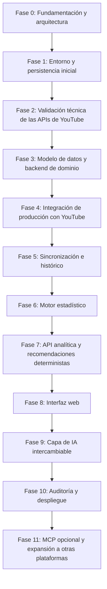

# Hoja de Ruta y Planificación por Fases — miConte (`docs/roadmap.md`)

El desarrollo de **miConte** se estructura en 12 fases secuenciales (Fase 0 a Fase 11) gobernadas por la skill `miconte-phase-workflow`.

**Regla de Oro:** Ninguna fase se considera aprobada solo porque el código se haya generado, y **nunca se avanza a la Fase $N+1$ sin haber verificado y aprobado formalmente los criterios de aceptación de la Fase $N$**. No se cambia esta numeración ni su alcance sin justificación explícita y aprobación previa.

---

## Fase 0: Fundamentación y arquitectura (Fase Actual)
* **Objetivo:** Definir el producto, acotar el MVP, diseñar la arquitectura modular, establecer el diccionario inicial de métricas, registrar las decisiones arquitectónicas (ADRs) e identificar riesgos, cuotas, permisos y compatibilidad del stack sin escribir código de producción prematuro.
* **Dependencias:** Ninguna.
* **Entregables:**
  * `README.md`
  * `docs/product-overview.md`
  * `docs/requirements.md`
  * `docs/architecture.md`
  * `docs/data-dictionary.md`
  * `docs/roadmap.md`
  * `docs/risks.md`
  * `docs/decisions/0001-...` a `0004-...`
* **Criterios de Aceptación:**
  * Documentación completa, consistente con la identidad `miConte` / `miconte` / `MICONTE_` / `miconte_db`.
  * Límites claros que aíslan el motor estadístico de FastAPI, LLMs y MCP.
  * Versiones recomendadas distinguidas de las versiones instaladas localmente, permisos y cuotas documentados con precisión, y numeración oficial de fases (0 a 11) consistente en todo el repositorio.

---

## Fase 1: Entorno y persistencia inicial
* **Objetivo:** Configurar la estructura inicial del proyecto backend en Python (`miconte`), la gestión de configuración con prefijo `MICONTE_`, la conexión inicial a PostgreSQL (`miconte_db`), la infraestructura de migraciones con Alembic y el arnés de pruebas con `pytest`, `ruff` y `mypy`.
* **Dependencias:** Fase 0 aprobada.
* **Entregables:**
  * `pyproject.toml`, `.env.example` (con variables `MICONTE_`) y estructura modular base del paquete `miconte`.
  * Configuración de conexión a PostgreSQL (`miconte_db`) mediante SQLAlchemy 2.0 y configuración inicial de Alembic (con migración base de verificación / salud).
  * Endpoint o comprobación de salud básica (`healthcheck`) y suite inicial de pruebas en `pytest`.
* **Criterios de Aceptación:**
  * Entorno Python reproducible y funcional con `pytest`, `ruff check .` y `mypy` pasando sin errores.
  * Conexión verificada contra `miconte_db` y ejecución limpia de `alembic upgrade head` y `alembic downgrade -1`.

---

## Fase 2: Validación técnica de las APIs de YouTube
* **Objetivo:** Comprobar empíricamente los mecanismos de autorización (API Key y OAuth 2.0 de usuario con alcances de solo lectura), los endpoints reales de `YouTube Data API v3`, `YouTube Analytics API v2` y, en lo relativo a métricas de alcance (impresiones y CTR), la distinción frente a `YouTube Reporting API v1`, antes de cerrar el modelo definitivo de dominio.
* **Dependencias:** Fase 1 aprobada.
* **Entregables:**
  * Prototipo/arnés de validación de contratos frente a `channels.list`, `playlistItems.list`, `videos.list` (`Data API v3`) y `reports.query` (`Analytics API v2`), más verificación documental/empírica de los reportes de alcance (`channel_reach_basic_a1` en `Reporting API v1`).
  * Pruebas automatizadas en `pytest` con respuestas simuladas/grabadas (`HTTPX`) y herramienta controlada de comprobación con credenciales del usuario.
  * Actualización de `docs/data-dictionary.md`, `docs/risks.md` y `docs/decisions/0004-...` con los hallazgos empíricos sobre permisos, dimensiones válidas, impresiones/CTR y costos de cuota.
* **Criterios de Aceptación:**
  * Confirmación documentada de qué métricas, dimensiones y alcances OAuth responden en cada endpoint oficial.
  * Todos los tests de contrato y validación en `pytest` pasan al 100% offline.

---

## Fase 3: Modelo de datos y backend de dominio
* **Objetivo:** Diseñar e implementar el esquema relacional definitivo de dominio en `miconte_db` (basado en los datos reales validados en la Fase 2), junto con las entidades de dominio, repositorios SQLAlchemy 2.0 y migraciones Alembic.
* **Dependencias:** Fase 2 aprobada.
* **Entregables:**
  * Modelos SQLAlchemy 2.0 y migraciones Alembic para canales (`channels`), videos (`videos`), credenciales OAuth cifradas, instantáneas públicas (`video_public_snapshots`), series diarias privadas (`video_daily_metrics`) y auditoría de ejecuciones (`sync_runs`).
  * Repositorios de acceso a datos y esquemas de dominio con trazabilidad de fuente, unidad y ventana temporal.
* **Criterios de Aceptación:**
  * Migraciones reversibles verificadas (`alembic upgrade head` / `downgrade`).
  * Índices, claves foráneas y restricciones validados conforme a `postgres-best-practices`.
  * Suite de pruebas de repositorios en `pytest` al 100% en verde.

---

## Fase 4: Integración de producción con YouTube
* **Objetivo:** Implementar los adaptadores de producción para `YouTube Data API v3`, `YouTube Analytics API v2` (y el mecanismo acordado en Fase 2 para métricas de alcance), incluyendo el flujo completo OAuth 2.0 (`readonly`), refresco seguro de tokens, control de presupuesto de cuota, paginación por lotes de 50 IDs y reintentos con *exponential backoff*.
* **Dependencias:** Fase 3 aprobada.
* **Entregables:**
  * Clientes de producción bajo `miconte.integrations.youtube` e implementación del puerto `ContentPlatformPort`.
  * Gestión segura y cifrada de tokens OAuth 2.0 y contabilidad de unidades de cuota por llamada.
* **Criterios de Aceptación:**
  * Pruebas unitarias y de integración con `HTTPX` cubriendo paginación, límites de cuota (`403 quotaExceeded` / `429`), expiración de tokens y parseo de datos.
  * Auditoría `security-review` sin hallazgos sobre el manejo de secretos y tokens OAuth.

---

## Fase 5: Sincronización e histórico
* **Objetivo:** Construir el orquestador de sincronización que coordina la ingesta desde los adaptadores de YouTube hacia `miconte_db`, garantizando idempotencia (`UPSERT`), conservación histórica controlada, ventana móvil de re-sincronización (para cubrir la latencia de 48–72h de Analytics) y registro de auditoría en `sync_runs`.
* **Dependencias:** Fase 4 aprobada.
* **Entregables:**
  * Servicio `miconte.sync` para sincronización inicial e incremental de catálogo, instantáneas públicas y series temporales privadas.
  * Manejo explícito de ventanas de observación incompletas (`incomplete_observation_window`) y datos suprimidos (`data_suppressed`).
* **Criterios de Aceptación:**
  * La ejecución repetida de la sincronización para un mismo canal y periodo no genera duplicados ni destruye instantáneas históricas previas.
  * Registro completo de trazabilidad en `sync_runs` verificado mediante pruebas en `pytest`.

---

## Fase 6: Motor estadístico
* **Objetivo:** Implementar el paquete puro e independiente `miconte.statistics` utilizando `pandas`, `NumPy`, `SciPy` y `statsmodels` (y `scikit-learn` solo si está justificado), cumpliendo con `miconte-statistical-validation`.
* **Dependencias:** Fase 5 aprobada.
* **Entregables:**
  * Cálculo determinista de métricas derivadas ($\text{CTR}$, $\text{APV}$, $\text{ER}$, $V_{24h}$, $V_{7d}$, $\text{NSC}_{1k}$) con fórmulas documentadas en LaTeX.
  * Evaluación de tamaño muestral, supuestos distribucionales (`Shapiro-Wilk`, `Kolmogorov-Smirnov`), intervalos de confianza al 95% ($\text{CI}_{95\%}$), tamaño del efecto, pruebas paramétricas/no paramétricas (`Mann-Whitney U`, `Wilcoxon`, `ttest_ind`) y análisis de series temporales.
  * Distinción formal entre datos ausentes, ventanas de observación incompletas y censura estadística por la derecha.
* **Criterios de Aceptación:**
  * Cero dependencias de `fastapi`, `sqlalchemy`, red, LLMs o MCP en `miconte.statistics`.
  * Pruebas exhaustivas en `pytest` para casos nominales, bordes (ceros, vacíos, $N$ pequeño) y distribuciones asimétricas.

---

## Fase 7: API analítica y recomendaciones deterministas
* **Objetivo:** Implementar el motor de recomendaciones deterministas (`miconte.recommendations`) basado en reglas y evidencia estadística sin LLM, y exponer todas las capacidades analíticas, de catálogo y de sincronización a través de la API REST en FastAPI (`miconte.api`).
* **Dependencias:** Fase 6 aprobada.
* **Entregables:**
  * Motor `miconte.recommendations` con reglas auditables, metadatos completos de evidencia y lenguaje estrictamente descriptivo/asociativo (nunca causal).
  * Routers FastAPI con `Annotated[..., Depends(...)]`, esquemas Pydantic v2 y documentación OpenAPI.
* **Criterios de Aceptación:**
  * Pruebas unitarias del motor de recomendaciones y pruebas de integración de endpoints con `HTTPX` pasando al 100% sin LLM activo.
  * Verificación de ausencia de afirmaciones causales no demostradas en las salidas de recomendación.

---

## Fase 8: Interfaz web
* **Objetivo:** Construir el frontend web de **miConte** en Angular (versión LTS soportada: Angular 20/21+) y TypeScript siguiendo las skills `angular-developer` y `frontend-design`.
* **Dependencias:** Fase 7 aprobada.
* **Entregables:**
  * Aplicación Angular con componentes standalone, Signals (`signal`, `computed`, `linkedSignal`, `resource`/`httpResource`), control flow moderno (`@if`, `@for`, `@switch`) e identidad **miConte**.
  * Vistas de estado del canal, explorador de publicaciones, comparador estadístico de cohortes (con intervalos de confianza, tamaño muestral y advertencias metodológicas) y panel de recomendaciones deterministas.
* **Criterios de Aceptación:**
  * `ng build` y chequeo de tipos TypeScript sin errores.
  * Pruebas de componentes y pruebas E2E con **Playwright** (`webapp-testing`) verificando el flujo completo sin LLM.

---

## Fase 9: Capa de IA intercambiable
* **Objetivo:** Incorporar el puerto `LLMProviderPort` (`miconte.ai`) con adaptador local para **Ollama** como primera opción y soporte para APIs externas, dedicado exclusivamente a interpretar y resumir los resultados ya calculados por el motor estadístico y el recomendador determinista.
* **Dependencias:** Fase 8 aprobada.
* **Entregables:**
  * Implementación de `NoOpLLMAdapter`, `OllamaAdapter` y `ExternalAPIAdapter` configurables vía `MICONTE_LLM_PROVIDER`.
  * Restricciones de *prompt* y validación para impedir que el LLM invente métricas o introduzca lenguaje causal, garantizando degradación elegante (*graceful degradation*) si el proveedor de IA no está disponible.
* **Criterios de Aceptación:**
  * El sistema sigue operando al 100% con `MICONTE_LLM_PROVIDER=none` o cuando Ollama está apagado.
  * El motor estadístico (`miconte.statistics`) no sufre modificaciones ni adquiere dependencias hacia `miconte.ai`.

---

## Fase 10: Auditoría y despliegue
* **Objetivo:** Ejecutar una auditoría integral de seguridad (`security-review`), rendimiento de consultas PostgreSQL (`postgres-best-practices`), calidad de código, cobertura de pruebas de extremo a extremo y preparación de artefactos de despliegue y documentación operativa.
* **Dependencias:** Fase 9 aprobada.
* **Entregables:**
  * Informe de auditoría de seguridad OWASP, optimización de índices/consultas (`EXPLAIN ANALYZE`) y empaquetado reproducible para ejecución local/producción.
  * Guía operativa de configuración, copias de seguridad (`pg_dump`/`pg_restore`) y mantenimiento de `miconte_db`.
* **Criterios de Aceptación:**
  * Cero vulnerabilidades de alta confianza pendientes, 100% de la suite de pruebas backend/frontend en verde y documentación final verificada.

---

## Fase 11: MCP opcional y expansión a otras plataformas
* **Objetivo:** Extender **miConte** más allá del MVP mediante un adaptador opcional para el Model Context Protocol (MCP) y/o la incorporación de nuevos adaptadores de plataforma (`ContentPlatformPort` para redes adicionales como TikTok o Instagram) reutilizando intacto el núcleo estadístico.
* **Dependencias:** Fase 10 aprobada (MVP completo y auditado).
* **Entregables:**
  * Adaptador opcional MCP desacoplado del núcleo y/o conectores de nuevas plataformas sociales.
* **Criterios de Aceptación:**
  * El núcleo de **miConte** mantiene su capacidad de ejecutarse con MCP deshabilitado sin degradación alguna.
